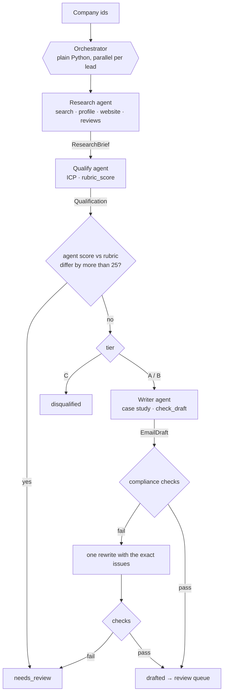

# multi-agent-sales-assistant

[](https://github.com/joaofrancowork/multi-agent-sales-assistant/actions/workflows/ci.yml)


Three Claude agents that do B2B prospecting the way a careful SDR would: **research** a
company with tools, **qualify** it against an ideal customer profile, and **draft** a short,
specific first email. A plain-Python orchestrator controls the flow, and the guardrails sit
in code where a model cannot skip them. **Nothing is ever sent**: drafts land in a review queue.

```text
$ sales-agents run
12 leads: 7 drafted, 0 needs_review, 5 disqualified, 0 failed · 0 tokens · $0.000   (--offline)
```

```text
## Estética Lumi · drafted
Tier A · score 80 (rubric 80) · target sector; 8 employees; no online booking; reminders: manual; ...

Subject: Bookings at Estética Lumi

Hi Estética Lumi team,

One of your reviews says: "Took two days to get an answer on Instagram." That usually means
bookings are being lost when the phone or inbox is busy.

A beauty clinic in Lisbon stopped losing Instagram booking requests: the assistant now answers
in under a minute, day or night.

Would a 15-minute call next week be useful?

Ana, Northwind Labs
Not relevant? Reply 'stop' and I won't write again.
```

Full sample output: [docs/sample-review-queue.md](docs/sample-review-queue.md). Every company,
review and case study in `data/` is fictional.

## Quick start

```bash
git clone https://github.com/joaofrancowork/multi-agent-sales-assistant && cd multi-agent-sales-assistant
uv sync && cp .env.example .env            # add ANTHROPIC_API_KEY
uv run sales-agents run                   # or: --offline to run with no key
```

Outputs go to `out/`: `<run>-review.md` (the queue a human reads), `<run>-results.json`, and
`traces/<run>.jsonl` (every model and tool call, with latency and tokens).

## Architecture



**The runtime** ([`runtime.py`](src/sales_agents/runtime.py)) is about 200 lines on top of the
Messages API tool-use loop, with no framework:

- An agent's tools are typed functions (Pydantic in, JSON out) sent with `strict: true` schemas.
- The agent finishes by calling its **submit tool**, whose schema *is* the agent's output type,
  so hand-offs between agents are validated objects, not free text.
- Bad tool input, tool errors and invalid submits go back to the model as `is_error` results
  so it can fix them. Unexpected exceptions are logged and hidden from the model.
- All tool results of a turn go back in **one** message, which keeps parallel tool calls working.
- Turn budget, a single nudge if the model stops without submitting, and `refusal` handling.
- The assistant content is returned **verbatim** on the next request, so thinking blocks stay valid.
- One JSON trace line per model call, tool call and outcome.

## Evaluation

`sales-agents eval` runs every company and compares the result with hand-labelled tiers
([`data/expected_tiers.json`](data/expected_tiers.json)):

| Metric | What it catches |
|---|---|
| Tier accuracy + confusion matrix | Wrong prioritisation |
| Contact precision | Emailing companies that should not be contacted (the costly error) |
| Compliance pass rate | Missing opt-out, invented claims, placeholders, overly long emails |
| Grounded signals | Research "evidence" that never appeared in any tool output (hallucination) |
| Tool calls and cost per lead | Agents that loop or over-fetch |

The offline run with the rule-based model passes every check (see
[docs/offline-eval.md](docs/offline-eval.md)). That is the floor: it shows the plumbing,
guardrails and metrics work end to end in CI. The interesting numbers come from running Claude
on the same set (`uv run sales-agents eval`); publishing them is tracked in the issues.

## Technical decisions

- **Orchestration in code, not a manager LLM.** The steps are known in advance, so a fixed flow
  is cheaper, predictable and testable. The LLM is used where judgement is needed: reading
  messy evidence, weighing it, and writing.
- **Model plus rubric.** A deterministic ICP score is both a tool the agent can use and a
  guardrail. Large disagreements are exactly the cases a human should look at.
- **Least privilege per agent.** The writer cannot browse; the researcher cannot write emails;
  only approved case studies can be cited.
- **Compliance as code.** Cold B2B email in the EU relies on legitimate interest, so every
  email has to identify the sender and include an opt-out. Checks run after the model, whatever
  it says it did.
- **Failure isolation.** Leads are processed in parallel; one failed lead never breaks the batch.
- **Testable without a key.** A scripted model replays exact turns (tool errors, invalid
  submits, refusals), and the tests run in about a second with 99% coverage.

## Project layout

```text
src/sales_agents/
  runtime.py         agent loop, typed tools, strict schemas, guardrails
  agents.py          research / qualify / writer: prompts and tool sets
  orchestrator.py    flow, parallelism, rubric and compliance gates
  tools/             directory (research), scoring (ICP rubric), compliance
  llm/               Claude client, scripted model (tests), demo model (offline)
  evaluation.py      metrics against labelled tiers
  tracing.py         JSONL traces
```

## Roadmap

- [ ] Publish Claude Opus 5.5 vs Sonnet 5.5 vs Haiku 5.5 results (quality, cost, latency)
- [ ] Prompt caching for the shared system prompts and ICP
- [ ] Real data adapters: business registry, web fetch, reviews API
- [ ] Web review queue with approve / edit / reject that feeds back into the eval set
- [ ] Message Batches for overnight runs at half the cost

## License

MIT.
